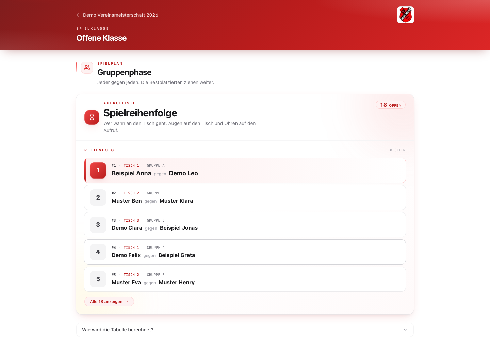

# SVUTT

SVUTT ist eine Turnierverwaltung für die Tischtennis-Abteilung des [SV 1945 Untereuerheim](https://sv-untereuerheim.de). Sie erstellt Auslosungen und Spielpläne und zeigt Ergebnisse und Tabellen während des Turniers öffentlich an.



Die Aufnahme zeigt eine Demo mit Beispieldaten.

## Funktionen

SVUTT verwaltet Spielklassen, Auslosung, Spielplan, Ergebnisse und Tabellen. Die öffentliche Ansicht zeigt den aktuellen Stand per Link oder QR-Code; die Verwaltung erfolgt im geschützten Admin-Bereich.

Unterstützt werden Gruppen mit KO-Phase, Rundenturniere, reines KO und Schweizer System. Auslosungen können zufällig, gesetzt oder manuell erfolgen. Mehr zu den [Turnierformaten und Abläufen](docs/tournament-formats.md).

## Stack

- **Next.js 16** mit App Router und **React 19.2**, öffentliche Seiten mit
  `dynamic = "force-dynamic"`, damit Ergebnisse sofort nach dem Eintragen
  sichtbar sind.
- **TypeScript** strict - `noUncheckedIndexedAccess`, `noImplicitOverride`,
  `noFallthroughCasesInSwitch`. Die Engine ist so geschrieben, als wäre
  der Compiler ein Test.
- **Hono** für die API. Ein einziger Handler unter
  `app/api/[[...route]]/route.ts`, Routen sind nach Datei aufgeteilt.
- **Drizzle ORM** auf **PostgreSQL**. Migrationen in `/drizzle`, Schema in
  `lib/db/schema.ts`.
- **Tailwind CSS v4** mit CSS-First-Theming (`@theme { … }`) und
  handgemachten Utilities (`btn`, `card`, `badge-*`).
- **Zod v4** an jeder Schreib-Route. Was durchs Schema kommt, vertraut der
  Handler.
- **jose** für HS256-Session-JWTs in einem HttpOnly-Cookie.
- **qrcode** fürs Share-Modal.
- **Vitest 4** + **PGlite** für Tests - die API-Suite startet Postgres in
  Node, kein Docker nötig.

---

## Loslegen

```bash
pnpm install
cp .env.example .env        # DATABASE_URL, ADMIN_PASSWORD, SESSION_SECRET setzen
pnpm db:migrate
pnpm dev                    # http://localhost:3000 - Admin auf /admin
```

`SESSION_SECRET` muss mindestens 16 Zeichen haben; `openssl rand -hex 32`
erzeugt einen geeigneten Wert. In Produktion `NODE_ENV=production` setzen,
damit das Session-Cookie das `Secure`-Flag bekommt.

### Skripte

| Skript | Was es tut |
| --- | --- |
| `pnpm dev` | Dev-Server (Turbopack). |
| `pnpm build` / `pnpm start` | Build und Produktionsstart. |
| `pnpm typecheck` | `tsc --noEmit` im strict-Modus. |
| `pnpm test` | Vitest - pure Engine-Tests **und** API-End-to-End auf [PGlite](https://pglite.dev). |
| `pnpm test:watch` | Dasselbe, aber mit Watch. |
| `pnpm db:generate` | Migration aus `schema.ts` erzeugen. |
| `pnpm db:push` | Schema direkt pushen (nur Dev). |
| `pnpm db:migrate` | SQL-Migrationen aus `/drizzle` ausführen. |
| `pnpm db:studio` | Drizzle Studio öffnen. |

---

## Datenmodell

```
Tournament ──∞ Category ──∞ Participant
                │
                ├──∞ Group ──∞ GroupMember ──→ Participant
                │
                └──∞ Match ──∞ MatchSet
                        │
                        ├─ winnerParticipant ──→ Participant
                        └─ sourceMatchA / sourceMatchB ──→ Match   (KO chaining)
```

Acht Tabellen insgesamt: `tournaments`, `categories`, `participants`,
`groups`, `group_members`, `matches`, `match_sets`, `sessions`. Format und
Auslosungsmodus sind Textspalten - ein neues Format ist eine Engine-Änderung,
keine Migration.

Die Wahrheit liegt in [`lib/db/schema.ts`](./lib/db/schema.ts).

---

## Engine

`lib/engine/` ist pures TypeScript - kein Next, keine DB, kein React.
Lässt sich aus einem CLI, einem Cron oder einem Test importieren, ohne
dass es nervt.

| Datei | Exportiert |
| --- | --- |
| `types.ts`           | `Player`, `SetScore`, `MatchOutcome`, `EngineMatch`, `EngineGroup`, `StandingRow`, `Bracket`, `BracketSlot`. |
| `sets.ts`            | `isValidSet`, `setWinner`, `computeMatchOutcome`, `validateMatchInput`. |
| `rng.ts`             | `createRng(seed)` - Mulberry32, plus `shuffle`. |
| `draw.ts`            | `computeGroupShape`, `drawGroups`, `orderBySeed`. |
| `roundRobin.ts`      | Berger-Tabelle für Round-Robin. |
| `standings.ts`       | `computeStandings` mit der Tiebreaker-Kette von oben. |
| `bracket.ts`         | `buildBracket` (Gruppen → KO mit Lucky Losern), `nextPowerOfTwo`. |
| `koOnly.ts`          | `buildKoOnly`, `seedingOrder` für reine KO-Turniere. |
| `roundRobinOnly.ts`  | Einzelgruppen-Round-Robin. |
| `swiss.ts`           | `planSwissRound`, `computeSwissStandings`, `suggestedSwissRounds`. |
| `schedule.ts`        | `scheduleMatches` (einfach) und `scheduleMatchesWithRest` (gibt Spielern Pausen zwischen ihren Spielen, wenn möglich). |
| `format.ts`          | Format-/Auslosungs-Enums, deutsche Labels, Mindestteilnehmerzahlen. |
| `randomResult.ts`    | Zufallsergebnisse für den Demo-Modus. |
| `tournamentStats.ts` | Aggregierte Statistiken fürs Admin-Dashboard. |

`lib/preview.ts` sitzt eine Ebene drüber und schätzt Spielzahl, KO-Größe,
Lucky-Loser-Plätze und Gesamtdauer, bevor der Admin auf "Anlegen" drückt.

---

## API

Alle Endpunkte unter `/api/*`, ein Hono-Handler unter
`app/api/[[...route]]/route.ts`.

**Public** - ohne Auth.

```
GET  /api/health
GET  /api/public/t/:slug
GET  /api/public/t/:slug/c/:catSlug
```

**Auth.**

```
POST /api/auth/login     { username, password }
POST /api/auth/logout
```

**Admin** - Session-Cookie nötig.

```
GET|POST            /api/tournaments
GET|PATCH|DELETE    /api/tournaments/:id
GET|POST            /api/tournaments/:id/categories

GET|PATCH|DELETE    /api/categories/:id
GET|POST            /api/categories/:id/participants
PATCH|DELETE        /api/categories/:id/participants/:pid
POST                /api/categories/:id/draw
PUT                 /api/categories/:id/groups/:gid/members
POST                /api/categories/:id/groups/move
POST                /api/categories/:id/bracket
POST                /api/categories/:id/swiss/round
POST                /api/categories/:id/populate-test-results

GET                 /api/matches/:id
PUT|DELETE          /api/matches/:id/result
PUT                 /api/matches/:id/played
```

---

## Auth

Ein Admin, Zugangsdaten aus der Umgebung. `POST /api/auth/login` vergleicht
das Passwort in konstanter Zeit, signiert ein HS256-JWT mit
`SESSION_SECRET` und setzt es als `svutt_session` (HttpOnly, SameSite=Lax,
in Produktion `Secure`, 7 Tage gültig).

Der Login ist pro IP rate-limited: nach 10 fehlgeschlagenen Versuchen
innerhalb von 15 Minuten kommt 15 Minuten lang ein `429` mit `Retry-After`.
Ein erfolgreicher Login setzt den Zähler zurück. Der IP-Zähler liegt im
Speicher, passt also zum Single-Instance-Deploy auf Railway.

`middleware.ts` schützt `/admin/:path*`: nicht eingeloggt → `/admin/login`,
schon eingeloggt auf der Login-Seite → `/admin`. Die Signatur wird bei
jedem geschützten Request neu geprüft.

Keine User-Tabelle, keine Registrierung, kein Passwort-Reset. Wer das
Passwort vergisst, ändert `ADMIN_PASSWORD` und deployt neu.

---

## Tests

```
tests/
├── engine/           # pure: sets, draw, roundRobin, standings, bracket,
│                     # koOnly, roundRobinOnly, swiss, schedule, preview,
│                     # plus eine vollständige Turnier-Simulation.
└── api/              # Hono + Drizzle gegen PGlite.
    └── setup.ts      # in-process Postgres pro Testdatei.
```

`pnpm test` zieht beides durch. Keine echte DB, kein Docker, keine
Fixture-Files. Auslosungstests sind dank Seed-RNG deterministisch.

---

## Deployment

### Railway

`railway.json` und `Dockerfile` liegen im Repo.

1. *New Project → Deploy from GitHub repo.*
2. *+ New → Database → PostgreSQL.*
3. Auf dem App-Service folgendes setzen:

   | Variable | Wert |
   | --- | --- |
   | `DATABASE_URL` | `${{Postgres.DATABASE_URL}}` *(Reference Variable)* |
   | `ADMIN_USERNAME` | Admin-Login |
   | `ADMIN_PASSWORD` | starkes Passwort |
   | `SESSION_SECRET` | `openssl rand -hex 32` |
   | `NEXT_PUBLIC_BASE_URL` | `https://${{RAILWAY_PUBLIC_DOMAIN}}` |

   `NEXT_PUBLIC_BASE_URL` wird zur **Build-Zeit** ins Bundle gebacken -
   also vor dem ersten Deploy setzen. Vorher Service exposen
   (*Settings → Networking → Generate Domain*), damit
   `RAILWAY_PUBLIC_DOMAIN` befüllt ist.

4. Deploy. Der Start-Befehl ist `pnpm db:migrate && pnpm start`, also
   laufen Migrationen automatisch durch.

5. `https://<dein-domain>/admin` aufrufen und einloggen.

### Docker (überall sonst)

Multi-Stage-Build, Node 22 Alpine, Non-Root-User, 3000/tcp:

```bash
docker build -t svutt .
docker run -p 3000:3000 \
  -e DATABASE_URL=... \
  -e ADMIN_PASSWORD=... \
  -e SESSION_SECRET=... \
  -e NEXT_PUBLIC_BASE_URL=https://your.domain \
  svutt
```

---

## Projektstruktur

```
app/                 Next.js-Routen
├── page.tsx           Liste der öffentlichen Turniere
├── t/[slug]/          öffentliche Turnieransicht
├── admin/             Wizard, Dashboard, Login
└── api/[[...route]]/  Hono-Mount

components/          React - getrennt nach admin/ und public/
lib/
├── db/                Drizzle-Client + Schema + Migrations-Runner
├── engine/            pure Turnierlogik
├── api/               Hono-Routen + Helfer
├── auth/              JWT-Session
├── displayName.ts     "Nachname Vorname" → "Vorname Nachname" für die UI
├── matchLabel.ts      Spielnummer + Tisch fürs Aufrufen
└── preview.ts         Vorschau-Schätzungen

tests/               Vitest - Engine + API
drizzle/             SQL-Migrationen
public/              logo.png
```

---

## Lizenz

MIT - siehe [LICENSE](./LICENSE). Forken, Logo (`public/logo.png`) und
Vereinsnamen austauschen, eigene Vereinsmeisterschaft fahren.
